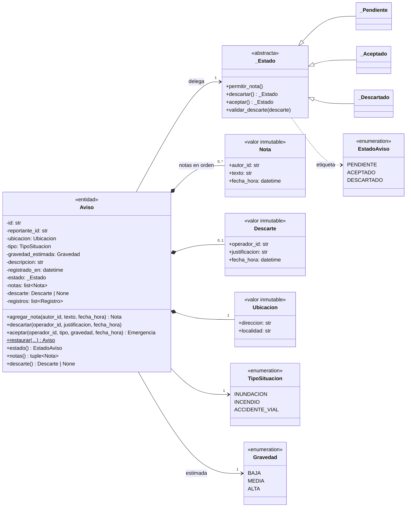
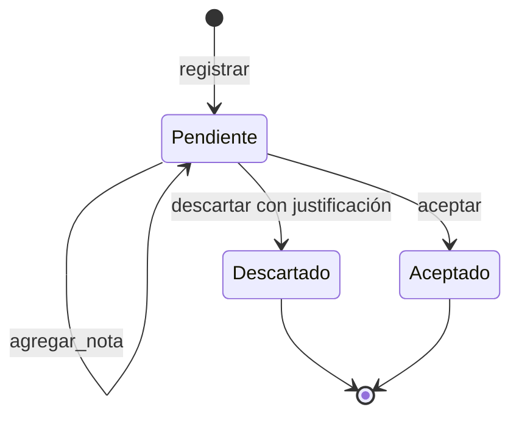

# Trabajo Práctico Integrador — Avance 1: Avisos y notas

**Paradigmas de Programación V · Facultad de Ingeniería del Ejército (FIE-UNDEF)**

**Alumno:** Francisco Acuña · **Entrega:** domingo 22 de noviembre de 2026 · **Repositorio:** [github.com/franacu/ProyectoFinal-PP5](https://github.com/franacu/ProyectoFinal-PP5) (tag `avance-1`)

---

## Índice

1. [Introducción](#1-introducción)
2. [Conceptos previos](#2-conceptos-previos)
3. [Análisis del enunciado](#3-análisis-del-enunciado)
4. [Diseño: diagrama de clases](#4-diseño-diagrama-de-clases)
5. [Ciclo de vida del aviso](#5-ciclo-de-vida-del-aviso)
6. [Tarjetas CRC](#6-tarjetas-crc)
7. [Reglas de negocio](#7-reglas-de-negocio)
8. [Verificación mediante pruebas](#8-verificación-mediante-pruebas)
9. [Decisión de diseño: quién verifica al reportante](#9-decisión-de-diseño-quién-verifica-al-reportante)
10. [Conclusión](#10-conclusión)
11. [Anexo: repositorio y ejecución](#anexo-repositorio-y-ejecución)

---

## 1. Introducción

El Trabajo Práctico Integrador consiste en desarrollar el sistema del **Centro Regional de Coordinación de Emergencias (CRCE)**, un organismo que recibe avisos sobre inundaciones, incendios y accidentes viales, los evalúa y organiza la respuesta con unidades operativas. El sistema completo incluye emergencias, misiones, unidades, una API, persistencia y una interfaz gráfica.

Este documento presenta el **Avance 1**, que resuelve una porción acotada de ese sistema: el **aviso** y sus **notas**. La consigna lo define como una *rebanada vertical*, es decir, una funcionalidad completa pero angosta, en lugar de una capa entera de todo el sistema. Se comienza por el dominio porque es la base sobre la que se construye el resto.

### 1.1 Objetivo

Diseñar e implementar, como clases de dominio con pruebas unitarias, tres operaciones del aviso:

1. **Registrarlo**, con su ubicación, tipo de situación, gravedad estimada y descripción.
2. **Agregarle notas** mientras está pendiente de evaluación.
3. **Descartarlo**, registrando una justificación.

### 1.2 Alcance

El trabajo se basa en dos párrafos del enunciado: el §2.1, que describe al reportante y sus avisos, y el §7.1, que describe la evaluación. Quedan **fuera** de este avance la aceptación del aviso y la creación de la emergencia, las misiones, las unidades, los recursos, la API HTTP, la persistencia, Docker y la autenticación.

El estado *aceptado* sí forma parte del modelo, porque la consigna exige que figure en el ciclo de vida del aviso, aunque la operación de aceptar no se evalúe en esta etapa.

### 1.3 Organización del documento

La sección 2 define los conceptos que se usan a lo largo del trabajo. La sección 3 analiza el enunciado y la 4 presenta el diseño de clases. Las secciones 5 y 6 muestran el ciclo de vida del aviso y las tarjetas CRC. La 7 explica cómo el código hace cumplir las reglas de negocio y la 8, cómo se verifican con pruebas. La sección 9 justifica una decisión de diseño pedida por la consigna y la 10 presenta las conclusiones.

---

## 2. Conceptos previos

Antes de presentar el diseño se definen los términos que se usan en el resto del documento.

| Concepto | Definición | Dónde aparece en el avance |
| --- | --- | --- |
| **Dominio** | Parte del programa que representa el problema real (avisos, notas, reglas) sin depender de tecnologías externas como bases de datos o servidores web. | Toda la carpeta `dominio/` está escrita solo con la biblioteca estándar de Python. |
| **Entidad** | Objeto que tiene identidad propia y que cambia a lo largo del tiempo. Dos entidades con los mismos datos siguen siendo distintas si su identificador es distinto. | `Aviso`: tiene un `id` y pasa de pendiente a descartado o aceptado. |
| **Objeto valor** | Objeto definido únicamente por sus datos, sin identidad propia. Dos objetos valor con los mismos datos son iguales. | `Nota`, `Descarte` y `Ubicacion`. |
| **Inmutabilidad** | Propiedad de un objeto que, una vez creado, no puede modificarse. En Python se logra con `@dataclass(frozen=True)`. | Una nota o un descarte no pueden cambiar después de creados. |
| **Encapsulamiento** | Principio por el cual los datos de un objeto solo se modifican a través de sus propios métodos. Por convención, un atributo con guion bajo inicial (`_id`) es privado. | Nadie puede escribir `aviso.estado = ...`: el estado solo cambia mediante `descartar()`. |
| **Catálogo cerrado** | Conjunto fijo de opciones válidas. En Python se representa con un `Enum`: un valor fuera de la lista no puede construirse. | `TipoSituacion` (inundación, incendio, accidente vial) y `Gravedad` (baja, media, alta). |
| **Patrón State** | Patrón de diseño en el que cada estado de un objeto es una clase distinta que decide qué operaciones se admiten. El objeto le *delega* esa decisión a su estado en lugar de preguntar con condicionales. | `_Pendiente`, `_Aceptado` y `_Descartado`. |
| **Composición** | Relación en la que una parte no existe sin su todo. En UML se dibuja con un rombo relleno. | Las notas y el descarte pertenecen a su aviso. |
| **Multiplicidad** | Cantidad de objetos que participan en una relación: `1` (exactamente uno), `0..1` (ninguno o uno), `0..*` (cero o más). | Un aviso tiene `0..*` notas y `0..1` descarte. |
| **Excepción de dominio** | Error con nombre propio que se lanza cuando una operación viola una regla del negocio. | `AvisoNoPendiente`, `JustificacionVacia`, `NotaInvalida`, entre otras. |
| **Prueba unitaria** | Función que ejecuta una parte del código y verifica automáticamente su resultado. Se ejecutan con la herramienta `pytest`. | 33 pruebas en `tests/test_avisos.py` y `tests/test_avisos_robustez.py`. |
| **Tarjeta CRC** | Técnica de diseño que describe cada clase con tres elementos: **C**lase, **R**esponsabilidades (qué sabe y qué hace) y **C**olaboradores (con quién trabaja). | Sección 6. |

---

## 3. Análisis del enunciado

Del enunciado se extraen las clases buscando qué se registra, quién lo hace y qué reglas se repiten. La consigna da una pista: el §2.1 alcanza para tres clases o más, y no todas tienen identidad propia.

| Lo que dice el enunciado | Sección | Qué se obtiene en el modelo |
| --- | --- | --- |
| Al registrar un aviso se indica su ubicación, tipo de situación, gravedad estimada y una descripción. | §2.1 | La entidad **Aviso** con esos atributos, y el valor **Ubicacion**. |
| El tipo de situación y la gravedad pertenecen a listas fijas. | §3 y §4 | Los catálogos **TipoSituacion** y **Gravedad**. |
| Mientras el aviso esté pendiente, su reportante puede agregar notas de texto, sin reemplazar los datos originales. | §2.1 | El método `agregar_nota()` y la regla de no modificar los datos originales. |
| Cada nota conserva autor, fecha y hora. | §2.1 | El valor **Nota** (autor, texto, fecha y hora). |
| Los avisos comienzan pendientes; un operador puede aceptarlos o descartarlos registrando una justificación. | §7.1 | Los estados **pendiente**, **aceptado** y **descartado**, y el valor **Descarte**. |
| Un aviso aceptado no puede evaluarse de nuevo y uno descartado no puede aceptarse después. | §7.1 | Los estados aceptado y descartado son **finales**: rechazan nuevas operaciones. |

### 3.1 Clases identificadas

- **Aviso** (entidad): es lo que el reportante informa y lo que cambia de estado.
- **Nota** y **Descarte** (objetos valor): nacen con todos sus datos y no cambian. No necesitan identidad propia, porque solo existen dentro de su aviso.
- **Ubicacion** (objeto valor): una dirección y una localidad.
- **TipoSituacion** y **Gravedad** (catálogos cerrados).
- **Estados del aviso**: una clase por cada estado del ciclo de vida, según el patrón State.

---

## 4. Diseño: diagrama de clases

El diagrama muestra cada clase con sus atributos y métodos, las relaciones entre ellas y su multiplicidad. Los atributos con `-` son privados; los métodos con `+` son públicos.



### 4.1 Justificación del diseño

- **Una sola entidad.** `Aviso` es la única clase con identidad, porque es la única que cambia a lo largo de su vida.
- **Objetos valor para lo que nace completo.** `Nota`, `Descarte` y `Ubicacion` se validan al crearse. Por eso no puede existir una nota sin autor ni un descarte sin justificación.
- **Composición.** Las notas y el descarte solo existen dentro de su aviso; por eso la relación es de composición y no una asociación simple.
- **Catálogos como `Enum`.** Un tipo de situación o una gravedad inventados no pueden construirse, de modo que nunca llegan a un aviso.
- **Estado como objeto.** El aviso no pregunta en qué estado está: le delega la decisión a su objeto estado. Hacia afuera solo se expone el nombre público (`EstadoAviso`), nunca el objeto interno.
- **Lectura sin escritura.** Los datos del aviso se leen mediante propiedades sin *setter*, y las notas se entregan como **tupla**, una colección que no puede modificarse. Así, la única forma de agregar una nota es `agregar_nota()`, que verifica las reglas.

Los elementos `aceptar()`, `restaurar()` y `registros` figuran en el diagrama porque están en el código entregado: el trabajo siguió avanzando hacia el TP final. No forman parte de la evaluación de este avance, salvo `restaurar()`, que se usa en una prueba (sección 8).

---

## 5. Ciclo de vida del aviso

Todo aviso nace **pendiente** y termina en uno de dos estados finales: **descartado** o **aceptado**. Un estado final no admite ninguna operación más.



La tabla detalla qué responde cada estado a cada uno de los métodos que define la clase abstracta `_Estado`:

| Estado | `permitir_nota()` | `descartar()` | `aceptar()` | `validar_descarte()` |
| --- | --- | --- | --- | --- |
| **Pendiente** | Admite la nota | Pasa a Descartado | Pasa a Aceptado | No debe tener descarte |
| **Aceptado** | Rechaza (`AvisoNoPendiente`) | Rechaza (`AvisoNoPendiente`) | Rechaza (`AvisoNoPendiente`) | No debe tener descarte |
| **Descartado** | Rechaza (`AvisoNoPendiente`) | Rechaza (`AvisoNoPendiente`) | Rechaza (`AvisoNoPendiente`) | Debe conservar su descarte |

Un aviso se encuentra siempre en **un solo estado**. Esto evita usar tres variables booleanas (pendiente, aceptado, descartado) que podrían contradecirse entre sí. Además, como los estados no guardan datos propios, existe un único objeto de cada uno, que comparten todos los avisos.

Un descarte con justificación vacía se rechaza y el aviso permanece pendiente.

---

## 6. Tarjetas CRC

Cada tarjeta describe una clase con sus responsabilidades (qué sabe y qué hace) y sus colaboradores (con qué otras clases trabaja para cumplirlas).

### 6.1 Aviso (entidad)

| Responsabilidades | Colaboradores |
| --- | --- |
| Conoce su identificador, reportante, ubicación, tipo, gravedad estimada, descripción y fecha de registro. | Ubicacion, TipoSituacion, Gravedad |
| Nace pendiente y con todos sus datos validados. | _Estado |
| Agrega notas solo si está pendiente y solo de su reportante. | Nota, _Estado |
| Se descarta con una justificación y conserva quién lo descartó, cuándo y por qué. | Descarte, _Estado |
| Rechaza toda operación que su estado no admite, sin modificar nada. | _Estado |
| Permite consultar sus datos, pero no modificarlos desde afuera. | — |

### 6.2 Nota (objeto valor)

| Responsabilidades | Colaboradores |
| --- | --- |
| Conoce su autor, su texto y su fecha y hora. | — |
| Se valida al crearse: rechaza un autor vacío, un texto vacío o la falta de fecha (`NotaInvalida`). | La crea Aviso |
| No cambia después de creada. | — |

### 6.3 Descarte (objeto valor)

| Responsabilidades | Colaboradores |
| --- | --- |
| Conoce el operador que descartó, la justificación y la fecha y hora. | — |
| Rechaza una justificación vacía o de solo espacios (`JustificacionVacia`) y la falta de operador o de fecha (`DescarteInvalido`). | Lo crea Aviso |
| No cambia después de creado. | — |

### 6.4 Ubicacion (objeto valor)

| Responsabilidades | Colaboradores |
| --- | --- |
| Conoce la dirección y la localidad. | — |
| Se valida al crearse: ambos datos son obligatorios (`DatoDeAvisoInvalido`). | — |

### 6.5 Estados del aviso: _Pendiente, _Aceptado y _Descartado

| Responsabilidades | Colaboradores |
| --- | --- |
| Deciden si el aviso admite una nota. | Aviso, que les delega la decisión |
| Deciden a qué estado se pasa al descartar o aceptar, o rechazan la operación con `AvisoNoPendiente`. | Aviso |
| Conocen su nombre público. | EstadoAviso |

---

## 7. Reglas de negocio

Una **regla de negocio** es una condición que el sistema debe respetar siempre, independientemente de quién o cómo lo use. La consigna fija seis reglas para este avance; todas viven en el objeto que tiene los datos, no en las pruebas ni en un programa principal.

| Regla | Enunciado | Dónde se cumple en el código |
| --- | --- | --- |
| **R1** | Un aviso nace pendiente, con ubicación, tipo de situación, gravedad estimada, descripción, reportante y fecha y hora de registro. | Constructor de `Aviso` y su función privada `_validar_datos` |
| **R2** | Mientras el aviso está pendiente se le pueden agregar notas; cada nota conserva autor, fecha y hora. | `Aviso.agregar_nota()` y la clase `Nota` |
| **R3** | Agregar una nota no cambia ningún dato original del aviso. | Propiedades sin *setter*; `agregar_nota()` solo agrega a la lista de notas |
| **R4** | Descartar exige una justificación no vacía; el aviso conserva esa justificación y su fecha. | `Aviso.descartar()` y la clase `Descarte` |
| **R5** | Un aviso que ya no está pendiente rechaza nuevas notas y nuevas evaluaciones, incluido un segundo descarte. | Clases `_Aceptado` y `_Descartado` |
| **R6** | Una operación rechazada no deja cambios: falla antes de modificar el objeto. | Orden de cada método: primero valida, al final modifica |

### 7.1 Cómo se cumple la regla R6

Cada operación realiza primero todo lo que puede fallar y modifica el aviso solo al final. Por ejemplo, `descartar()` sigue estos pasos:

1. Consulta al estado actual si admite el descarte. Si el aviso no está pendiente, lanza `AvisoNoPendiente`.
2. Crea el objeto `Descarte`, que se valida solo. Si la justificación está vacía, lanza `JustificacionVacia`.
3. Prepara el registro histórico de la operación.
4. Recién entonces modifica el aviso: guarda el descarte y el nuevo estado.

Si falla cualquiera de los tres primeros pasos, el aviso queda exactamente como estaba.

### 7.2 Datos que llegan desde afuera

Dos decisiones refuerzan las reglas:

- **La fecha entra como parámetro.** Ningún método consulta la hora del sistema (`datetime.now()`). Así, cada prueba sabe exactamente qué fecha esperar, y en el sistema completo será la capa de servicio la que entregue la hora real.
- **Un error con nombre por cada motivo.** Todas las excepciones heredan de `ErrorDeDominio`. Las pruebas pueden verificar la regla exacta que se violó, y la futura API podrá distinguir un rechazo de otro por su tipo, no por el texto del mensaje.

---

## 8. Verificación mediante pruebas

Las **33 pruebas** del avance pasan sin errores. Cada regla se prueba desde tres lados: el caso correcto, el rechazo y el estado en que queda el objeto después.

Todas las pruebas siguen dos criterios de la consigna:

- **Los rechazos usan excepciones de dominio.** Se verifican con `pytest.raises` y una excepción propia, nunca con un `ValueError` genérico. Después del rechazo, la prueba comprueba que el objeto no cambió.
- **El nombre de cada prueba dice la regla que prueba.** Por ejemplo, `test_r5_r6_aviso_descartado_rechaza_nuevas_notas_sin_cambiar_las_existentes` prueba las reglas R5 y R6.

### 8.1 Escenarios obligatorios

| N.º | Escenario | Reglas | Prueba |
| --- | --- | --- | --- |
| 1 | Un aviso recién registrado está pendiente, sin notas ni descarte. | R1 | `test_r1_aviso_nuevo_nace_pendiente_sin_notas_ni_descarte` |
| 2 | Una nota en un aviso pendiente conserva autor, fecha y hora. | R2 | `test_r2_nota_en_aviso_pendiente_conserva_autor_fecha_y_hora` |
| 3 | Dos notas se conservan en el orden en que llegaron. | R2 | `test_r2_dos_notas_se_conservan_en_orden_de_llegada` |
| 4 | Después de una nota, ubicación, tipo, gravedad y descripción siguen iguales. | R3 | `test_r3_agregar_nota_no_cambia_datos_originales` |
| 5 | Descartar con justificación: queda descartado y conserva la justificación y la fecha. | R4 | `test_r4_descartar_con_justificacion_conserva_justificacion_y_fecha` |
| 6 | Una justificación vacía o de solo espacios se rechaza y el aviso sigue pendiente. | R4, R6 | `test_r4_r6_descartar_con_justificacion_vacia_se_rechaza_y_sigue_pendiente` |
| 7 | Una nota a un aviso descartado se rechaza y las notas no cambian. | R5, R6 | `test_r5_r6_aviso_descartado_rechaza_nuevas_notas_sin_cambiar_las_existentes` |
| 8 | Un segundo descarte se rechaza y se conserva la justificación original. | R5, R6 | `test_r5_r6_segundo_descarte_se_rechaza_y_conserva_justificacion_original` |
| 9 | Una nota a un aviso aceptado se rechaza. | R5 | `test_r5_r6_aviso_aceptado_rechaza_nuevas_notas` |

**Escenario 9: un aviso aceptado sin usar `aceptar()`.** La consigna pide construir ese aviso sin implementar la aceptación. Para eso se usa el método de clase `Aviso.restaurar()`, que reconstruye un aviso en cualquier estado coherente. Es el mismo mecanismo que usará la persistencia para leer un aviso guardado en la base de datos.

### 8.2 Pruebas adicionales

| Prueba | Qué verifica |
| --- | --- |
| `test_r1_aviso_rechaza_datos_invalidos_o_fuera_de_catalogo` | Un tipo o una gravedad fuera de catálogo, o una descripción o un reportante vacíos, impiden crear el aviso. |
| `test_r1_ubicacion_incompleta_se_rechaza_con_error_de_dominio` | Una ubicación sin dirección o sin localidad no puede existir. |
| `test_r2_nota_vacia_se_rechaza_y_no_se_agrega`, `test_r2_nota_sin_fecha_…` y `test_r2_nota_sin_autor_…` | Una nota incompleta se rechaza y la lista de notas no cambia. |
| `test_r2_notas_no_se_pueden_modificar_desde_afuera` | No es posible agregar una nota salteando `agregar_nota()`. |
| `test_r2_nota_de_otro_autor_se_rechaza_y_no_se_agrega` | Solo el reportante agrega notas (sección 9). |
| `test_r4_r6_descarte_sin_operador_o_sin_fecha_se_rechaza_y_sigue_pendiente` | Un descarte incompleto se rechaza sin modificar el aviso. |
| `test_r5_r6_aviso_aceptado_rechaza_descarte` | Un aviso aceptado tampoco puede descartarse. |
| `test_restaurar_rechaza_…` (tres pruebas) | No se puede reconstruir un aviso con un estado y un descarte contradictorios. |

---

## 9. Decisión de diseño: quién verifica al reportante

La consigna plantea una pregunta para la defensa: el enunciado dice que *su* reportante puede agregar notas al aviso, pero ¿quién lo verifica, el propio aviso o la capa que recibe al usuario autenticado?

Para responderla conviene distinguir dos preguntas diferentes:

- **Autenticación:** ¿quién es el usuario que hace el pedido y qué perfil tiene? Es un problema técnico de seguridad.
- **Regla de negocio:** ¿este usuario puede agregar notas a *este* aviso en particular? Depende de los datos del aviso.

**Respuesta elegida: lo verifica el Aviso.**

1. **Es una regla del negocio.** El §2.1 la establece como parte del comportamiento del aviso, y el aviso ya conoce a su reportante. Es el objeto que tiene el dato necesario para decidir.
2. **No puede saltearse.** Si la regla viviera en la API, cualquier otra puerta de entrada al sistema (otro *endpoint*, un script o una prueba) podría agregar notas sin verificarla. Dentro del aviso, todo camino pasa por ella.
3. **Cada capa hace su parte.** La capa HTTP autentica al usuario, comprueba que tenga el perfil de reportante y le pasa su identificador al aviso. El aviso decide si ese identificador corresponde a su reportante.

**En el código:** `agregar_nota()` compara el `autor_id` recibido con el reportante del aviso y, si no coinciden, lanza la excepción `NotaDeOtroAutor` antes de crear la nota. Lo verifica la prueba `test_r2_nota_de_otro_autor_se_rechaza_y_no_se_agrega`.

---

## 10. Conclusión

El Avance 1 cumple su objetivo: un aviso puede registrarse, recibir notas y descartarse, y las seis reglas de la consigna se cumplen y se verifican con 33 pruebas que pasan sin errores.

El trabajo deja tres aprendizajes que se aplicarán al resto del TP:

1. **Las reglas viven junto a los datos.** Cada regla la hace cumplir el objeto que tiene la información para decidirla, y no una prueba ni un programa principal. Por eso no hay forma de saltearlas.
2. **Distinguir entidades de objetos valor simplifica el diseño.** Solo el aviso cambia; las notas, el descarte y la ubicación nacen válidos y no cambian nunca, lo que elimina toda una clase de errores.
3. **Fallar antes de modificar.** Validar todo primero y modificar al final garantiza que una operación rechazada no deje al objeto en un estado intermedio.

El mismo proceso usado aquí (leer el enunciado, identificar las clases y sus responsabilidades, y escribir cada regla junto con la prueba que la verifica) es el que se repite en el resto del sistema: la emergencia, las misiones y las unidades. El repositorio ya avanza en esa dirección, y este diseño servirá como base de la primera entrega del 24 de noviembre.

---

## Anexo: repositorio y ejecución

El código está en [github.com/franacu/ProyectoFinal-PP5](https://github.com/franacu/ProyectoFinal-PP5). El tag `avance-1` marca exactamente la versión entregada, aunque el repositorio siga creciendo.

| Archivo | Contenido |
| --- | --- |
| `dominio/aviso.py` | Aviso, Nota, Descarte y los estados del aviso |
| `dominio/catalogos.py` | Catálogos cerrados: TipoSituacion y Gravedad |
| `dominio/valores.py` | Ubicacion y las validaciones compartidas |
| `dominio/errores.py` | Excepciones de dominio |
| `tests/test_avisos.py` | Pruebas de las reglas y los nueve escenarios |
| `tests/test_avisos_robustez.py` | Pruebas adicionales de casos límite |
| `docs/avance-1.md` | Este documento |

Para ejecutar las pruebas se necesita Python 3.13 y la herramienta `uv`:

```bash
git clone https://github.com/franacu/ProyectoFinal-PP5.git
cd ProyectoFinal-PP5
git checkout avance-1
uv sync
uv run pytest tests/test_avisos.py tests/test_avisos_robustez.py
```

Resultado esperado: **33 passed**.
