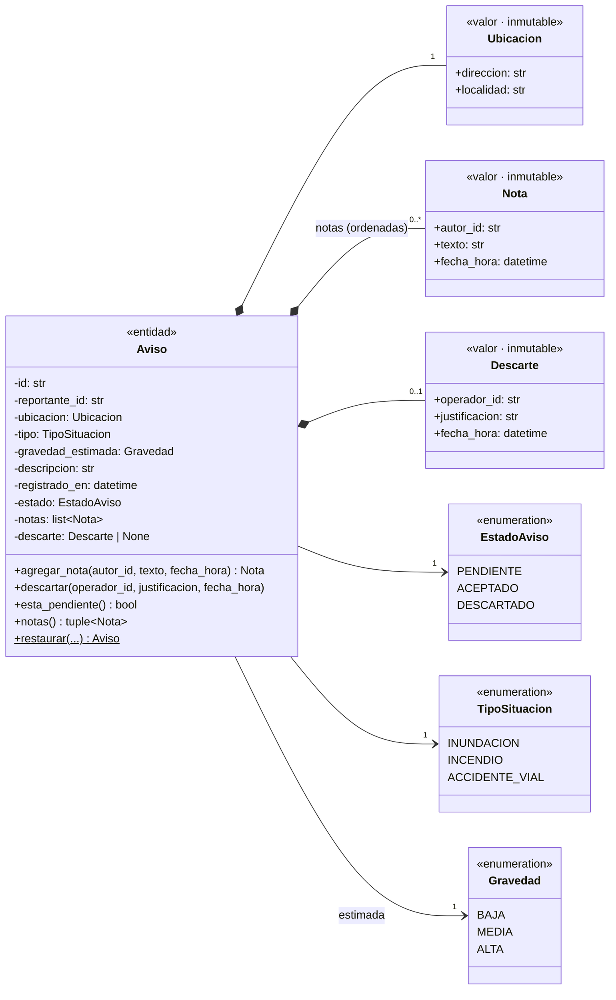
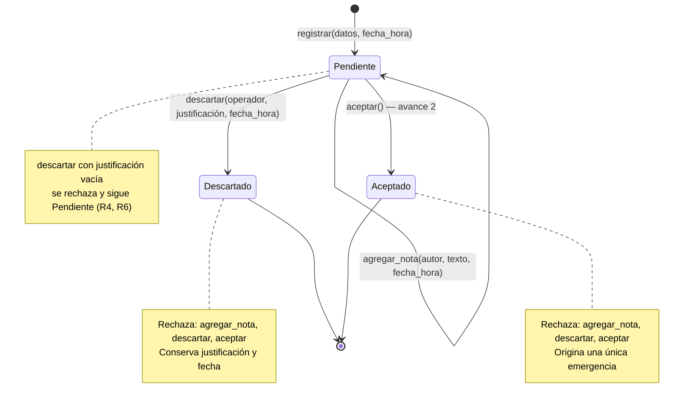

# Avance 1 — Avisos y notas

Rebanada vertical: **registrar** un aviso, **agregarle notas** y **descartarlo** (§2.1, §7.1).
Dominio en Python puro (sin FastAPI, Pydantic ni Mongo).

## 1. Diagrama de clases

**Por qué así**

- `Aviso` es la única **entidad**: tiene identidad (`id`) y cambia de estado.
- `Ubicacion`, `Nota` y `Descarte` son **objetos valor** (`@dataclass(frozen=True)`): se validan al nacer, no cambian y no tienen identidad propia. Una nota sin autor o un descarte sin justificación no pueden existir.
- Composición (`*--`): las notas y el descarte no viven fuera de su aviso.
- `TipoSituacion` y `Gravedad` son `Enum`: un valor fuera de catálogo no se puede construir.
- `aviso.notas` devuelve una **tupla**: desde afuera no hay `append`, la única puerta es `agregar_nota()`.

## 2. Diagrama de estados del aviso

| Operación       | Pendiente          | Aceptado            | Descartado          |
|-----------------|--------------------|---------------------|---------------------|
| `agregar_nota`  | ✅ queda Pendiente | ❌ `AvisoNoPendiente` | ❌ `AvisoNoPendiente` |
| `descartar`     | ✅ → Descartado    | ❌ `AvisoNoPendiente` | ❌ `AvisoNoPendiente` |
| `aceptar` (av. 2) | ✅ → Aceptado    | ❌                   | ❌                   |

## 3. Tarjetas CRC

| **Aviso** (entidad) | |
|---|---|
| **Sabe** | su id, reportante, ubicación, tipo, gravedad estimada, descripción, fecha de registro, estado, notas y descarte |
| **Hace** | se registra pendiente; agrega notas solo si está pendiente; se descarta con justificación; rechaza toda operación fuera de su estado sin cambiar nada |
| **Colabora con** | Ubicacion, Nota, Descarte, EstadoAviso, TipoSituacion, Gravedad |

| **Nota** (valor) | |
|---|---|
| **Sabe** | autor, texto, fecha y hora |
| **Hace** | se valida al crearse (autor y texto no vacíos); no cambia |
| **Colabora con** | — (la crea Aviso) |

| **Descarte** (valor) | |
|---|---|
| **Sabe** | operador, justificación, fecha y hora |
| **Hace** | rechaza justificación vacía o solo espacios; no cambia |
| **Colabora con** | — (lo crea Aviso) |

| **Ubicacion** (valor) | |
|---|---|
| **Sabe** | dirección y localidad |
| **Hace** | se valida al crearse; dos ubicaciones con los mismos datos son iguales |
| **Colabora con** | — |

## 4. Reglas → tests

| Regla | Tests |
|---|---|
| R1 | `test_r1_aviso_nuevo_nace_pendiente_sin_notas_ni_descarte`, `test_r1_aviso_rechaza_datos_invalidos_o_fuera_de_catalogo` |
| R2 | `test_r2_nota_en_aviso_pendiente_conserva_autor_fecha_y_hora`, `test_r2_dos_notas_se_conservan_en_orden_de_llegada`, `test_r2_nota_vacia_se_rechaza_y_no_se_agrega`, `test_r2_notas_no_se_pueden_modificar_desde_afuera` |
| R3 | `test_r3_agregar_nota_no_cambia_datos_originales` |
| R4 | `test_r4_descartar_con_justificacion_conserva_justificacion_y_fecha`, `test_r4_r6_descartar_con_justificacion_vacia_...` |
| R5 / R6 | `test_r5_r6_aviso_descartado_rechaza_nuevas_notas_...`, `test_r5_r6_segundo_descarte_...`, `test_r5_r6_aviso_aceptado_rechaza_nuevas_notas`, `test_r5_r6_aviso_aceptado_rechaza_descarte` |

## 5. Decisiones para la defensa

- **Fecha como parámetro.** Ninguna operación llama a `datetime.now()`; el test sabe qué fecha esperar. La capa de servicio pasará la hora real.
- **Un solo estado.** `EstadoAviso` es un `Enum` en un solo atributo; no hay booleanos que puedan contradecirse. Con tres estados y reglas simples, el patrón State sería sobre-diseño; si en emergencias/misiones las reglas por estado crecen, se evalúa.
- **Falla antes de modificar (R6).** Cada método primero verifica el estado y construye el objeto valor (que se autovalida); recién después toca los atributos.
- **Aviso aceptado sin `aceptar()`.** `Aviso.restaurar(...)` reconstruye un aviso en cualquier estado coherente. No es un atajo para tests: es lo que va a usar el repositorio de Mongo para rehidratar avisos.
- **¿Quién verifica que la nota la agrega su reportante?**
  Postura elegida: **el Aviso**. La regla "solo su reportante puede agregar notas" es de negocio (§2.1) y el aviso ya conoce a su `reportante_id`; si quedara en la API, otro punto de entrada (un script, otro endpoint) podría saltearla. La capa HTTP se encarga de *quién es* el usuario (autenticación, perfil Reportante) y le pasa su id al aviso, que decide si coincide. En el avance 2 se agrega `agregar_nota` → `NotaDeOtroAutor` si `autor_id != reportante_id`.
