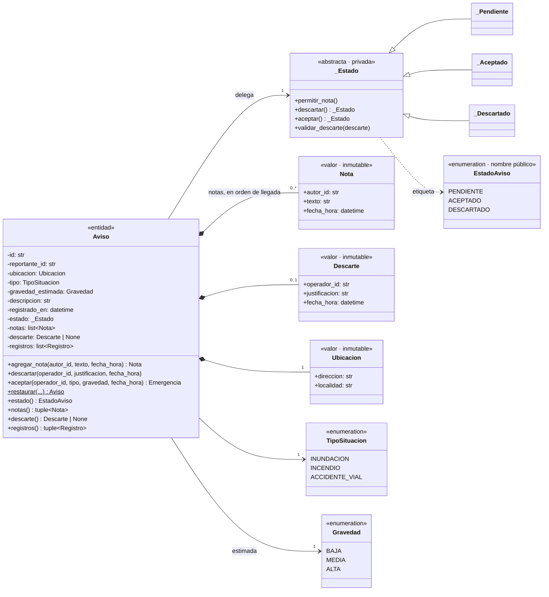
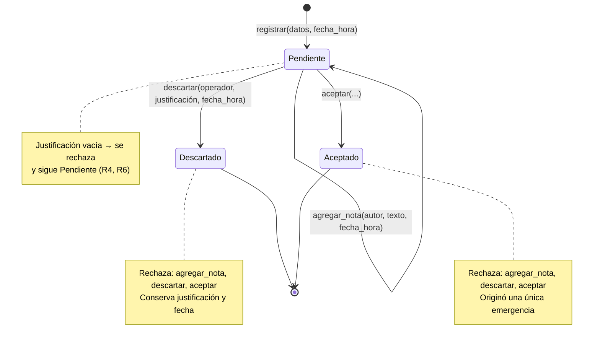

# Avance 1 — Avisos y notas

**TP Integrador 2026 · Paradigmas de Programación V · FIE-UNDEF**
Entrega: domingo 22/11/2026 · tag `avance-1`

Rebanada vertical del CRCE: **registrar** un aviso, **agregarle notas** y **descartarlo** (§2.1 y §7.1 del enunciado).
El dominio está escrito en Python puro: solo biblioteca estándar, sin FastAPI, Pydantic ni Mongo.

> Este documento cubre **solo el Avance 1**. El repositorio sigue creciendo hacia el TP final
> (emergencias, misiones, unidades); lo que no forma parte de esta rebanada se aclara donde aparece.

| | |
|---|---|
| **Código del avance** | `dominio/aviso.py` (Aviso, Nota, Descarte y sus estados) · `dominio/catalogos.py` · `dominio/valores.py` · `dominio/errores.py` |
| **Pruebas del avance** | `tests/test_avisos.py` · `tests/test_avisos_robustez.py` (33 pruebas) |
| **Cómo correrlas** | `uv sync` y después `uv run pytest tests/test_avisos.py tests/test_avisos_robustez.py` |

---

## 1. Diagrama de clases

**Por qué así**

- **Tres clases salen de §2.1**, y no todas tienen identidad propia (la pista de la consigna):
  - `Aviso` es la única **entidad**: tiene `id` y cambia de estado a lo largo de su vida.
  - `Nota` y `Descarte` son **objetos valor** (`@dataclass(frozen=True)`): se validan al nacer, no cambian y no tienen identidad. Una nota sin autor o un descarte sin justificación no pueden existir.
  - `Ubicacion` también es un valor: dos ubicaciones con los mismos datos son la misma.
- **Composición** (`*--`): las notas y el descarte no existen fuera de su aviso.
- **Catálogos cerrados** (§3 y §4): `TipoSituacion` y `Gravedad` son `Enum`. Un valor fuera de catálogo no se puede construir, así que nunca llega a un aviso.
- **El estado es un objeto** (patrón State): `Aviso` no pregunta "¿estás pendiente?"; le delega la decisión a `_Estado`. Afuera solo se ve el nombre público (`EstadoAviso`), nunca el objeto.
- **Nada se modifica desde afuera**: todo se lee con propiedades sin setter, y `notas` y `registros` se entregan como **tupla**. `aviso.notas.append(...)` no existe: la única puerta es `agregar_nota()`.

**Fuera del alcance de este avance**: `aceptar()` y `registros` ya están en el código porque el TP siguió avanzando
(aceptar origina la `Emergencia`, §7.1; los registros son el historial de §9). El avance no los evalúa;
figuran en el diagrama para que el diseño coincida con el código entregado.

---

## 2. Diagrama de estados del aviso

**Qué admite cada estado.** Cada fila es una clase (`_Pendiente`, `_Aceptado`, `_Descartado`) y cada columna, uno de los métodos que define `_Estado`:

| Estado | `permitir_nota()` | `descartar()` | `aceptar()` | `validar_descarte()` |
|---|---|---|---|---|
| **Pendiente** | ✅ admite | ✅ → Descartado | ✅ → Aceptado | no debe tener descarte |
| **Aceptado** | ❌ `AvisoNoPendiente` | ❌ `AvisoNoPendiente` | ❌ `AvisoNoPendiente` | no debe tener descarte |
| **Descartado** | ❌ `AvisoNoPendiente` | ❌ `AvisoNoPendiente` | ❌ `AvisoNoPendiente` | debe conservar su descarte |

Un aviso está siempre en **un solo estado**: no hay tres booleanos (`pendiente`, `aceptado`, `descartado`) que puedan contradecirse.

---

## 3. Tarjetas CRC

### Aviso — entidad

| Responsabilidades (qué sabe y qué hace) | Colaboradores |
|---|---|
| Sabe su id, reportante, ubicación, tipo, gravedad estimada, descripción y fecha de registro. | `Ubicacion`, `TipoSituacion`, `Gravedad` |
| Nace pendiente, con todos sus datos validados (R1). | `_Estado` (`_Pendiente`) |
| Agrega notas solo si está pendiente y solo de su reportante (R2, §2.1). | `Nota`, `_Estado` |
| Se descarta con una justificación y conserva quién, cuándo y por qué (R4). | `Descarte`, `_Estado` |
| Rechaza toda operación que su estado no admite, sin cambiar nada (R5, R6). | `_Estado` |
| Entrega sus datos para leer, sin permitir modificarlos (R3). | — |

### Nota — valor inmutable

| Responsabilidades | Colaboradores |
|---|---|
| Sabe su autor, su texto y su fecha y hora. | — |
| Se valida al crearse: rechaza autor vacío, texto vacío o sin fecha (`NotaInvalida`). | — (la crea `Aviso`) |
| No cambia después de creada. | — |

### Descarte — valor inmutable

| Responsabilidades | Colaboradores |
|---|---|
| Sabe qué operador descartó, la justificación y la fecha y hora. | — |
| Rechaza una justificación vacía o de solo espacios (`JustificacionVacia`), y un descarte sin operador o sin fecha (`DescarteInvalido`). | — (lo crea `Aviso`) |
| No cambia después de creado. | — |

### Ubicacion — valor inmutable

| Responsabilidades | Colaboradores |
|---|---|
| Sabe la dirección y la localidad. | — |
| Se valida al crearse: las dos son obligatorias (`DatoDeAvisoInvalido`). | — |

### _Estado (`_Pendiente`, `_Aceptado`, `_Descartado`) — clases privadas del módulo

| Responsabilidades | Colaboradores |
|---|---|
| Decide si se admite una nota. | `Aviso` (le delega) |
| Decide a qué estado se pasa al descartar o aceptar, o rechaza con `AvisoNoPendiente`. | `Aviso` |
| Sabe su nombre público. | `EstadoAviso` |

---

## 4. Reglas que hace cumplir el código

| # | Regla | Dónde vive en el código |
|---|---|---|
| **R1** | Un aviso nace pendiente, con ubicación, tipo, gravedad estimada, descripción, reportante y fecha de registro. | `Aviso.__init__` y la función privada `_validar_datos` |
| **R2** | Mientras está pendiente se le agregan notas; cada nota conserva autor, fecha y hora. | `Aviso.agregar_nota` y `Nota` |
| **R3** | Agregar una nota no cambia ningún dato original. | propiedades sin setter; `agregar_nota` solo toca la lista de notas |
| **R4** | Descartar exige justificación no vacía; el aviso conserva justificación y fecha. | `Aviso.descartar` y `Descarte` |
| **R5** | Un aviso no pendiente rechaza notas y nuevas evaluaciones; un segundo descarte también. | `_Aceptado` y `_Descartado` |
| **R6** | Una operación rechazada no deja cambios. | cada método valida todo **antes** de modificar el aviso |

**Cómo se cumple R6 (falla antes de modificar).** Por ejemplo, `descartar()`:

1. le pregunta al estado si admite descartarse → si no, `AvisoNoPendiente`;
2. crea el `Descarte`, que se valida solo → si la justificación está vacía, `JustificacionVacia`;
3. arma el registro de la operación;
4. **recién ahí** cambia el aviso: guarda el descarte y el nuevo estado.

Si algo falla en los pasos 1 a 3, el aviso queda exactamente como estaba.

---

## 5. Pruebas: las reglas y los escenarios obligatorios

Cada rechazo se prueba con `pytest.raises` y una **excepción propia del dominio** (no `ValueError`), y después
se verifica que el objeto **no cambió**. Cada nombre de test dice la regla que prueba.

### Los 9 escenarios de la consigna

| # | Escenario | Regla | Test |
|---|---|---|---|
| 1 | Un aviso recién registrado está pendiente, sin notas ni descarte. | R1 | `test_r1_aviso_nuevo_nace_pendiente_sin_notas_ni_descarte` |
| 2 | Una nota en un aviso pendiente conserva autor, fecha y hora. | R2 | `test_r2_nota_en_aviso_pendiente_conserva_autor_fecha_y_hora` |
| 3 | Dos notas se conservan en el orden en que llegaron. | R2 | `test_r2_dos_notas_se_conservan_en_orden_de_llegada` |
| 4 | Después de una nota, ubicación, tipo, gravedad y descripción siguen iguales. | R3 | `test_r3_agregar_nota_no_cambia_datos_originales` |
| 5 | Descartar con justificación: queda descartado y conserva justificación y fecha. | R4 | `test_r4_descartar_con_justificacion_conserva_justificacion_y_fecha` |
| 6 | Justificación vacía o de solo espacios: se rechaza y sigue pendiente. | R4, R6 | `test_r4_r6_descartar_con_justificacion_vacia_se_rechaza_y_sigue_pendiente` |
| 7 | Nota a un aviso descartado: se rechaza y las notas no cambian. | R5, R6 | `test_r5_r6_aviso_descartado_rechaza_nuevas_notas_sin_cambiar_las_existentes` |
| 8 | Segundo descarte: se rechaza y conserva la justificación original. | R5, R6 | `test_r5_r6_segundo_descarte_se_rechaza_y_conserva_justificacion_original` |
| 9 | Nota a un aviso aceptado: se rechaza. | R5 | `test_r5_r6_aviso_aceptado_rechaza_nuevas_notas` |

**Escenario 9: cómo se arma un aviso aceptado sin usar `aceptar()`.** Con `Aviso.restaurar(...)`, que reconstruye
un aviso en cualquier estado coherente (es lo que usará el repositorio para leer avisos guardados). Antes de crear
nada, el estado nuevo valida que su descarte tenga sentido: un aviso aceptado no puede venir con descarte, y uno
descartado tiene que traerlo.

### Pruebas adicionales de la rebanada

| Test | Qué agrega |
|---|---|
| `test_r1_aviso_rechaza_datos_invalidos_o_fuera_de_catalogo` | Tipo o gravedad fuera de catálogo, descripción o reportante vacíos: no se construye (R1). |
| `test_r1_ubicacion_incompleta_se_rechaza_con_error_de_dominio` | Una ubicación sin dirección o localidad no existe. |
| `test_r2_nota_vacia_se_rechaza_y_no_se_agrega` · `test_r2_nota_sin_fecha_…` · `test_r2_nota_sin_autor_…` | Una nota incompleta se rechaza y la lista no cambia. |
| `test_r2_notas_no_se_pueden_modificar_desde_afuera` | `aviso.notas.append(...)` falla: no hay forma de saltear la regla. |
| `test_r2_nota_de_otro_autor_se_rechaza_y_no_se_agrega` | Solo el reportante agrega notas (ver la decisión de la sección 6). |
| `test_r4_r6_descarte_sin_operador_o_sin_fecha_se_rechaza_y_sigue_pendiente` | Un descarte incompleto se rechaza sin cambiar el aviso. |
| `test_r5_r6_aviso_aceptado_rechaza_descarte` | Un aviso aceptado tampoco puede descartarse. |
| `test_restaurar_rechaza_…` (3 pruebas) | No se puede reconstruir un aviso con estado y descarte contradictorios. |

**Resultado:** `uv run pytest tests/test_avisos.py tests/test_avisos_robustez.py` → **33 passed**.

---

## 6. Pregunta para la defensa: ¿quién verifica que la nota la agregue su reportante?

**Respuesta elegida: el Aviso.**

- **Es una regla de negocio**, no de seguridad: §2.1 dice que *su* reportante puede agregar notas. El aviso ya
  conoce a su `reportante_id`, así que es el objeto que tiene el dato para decidir. Si la regla viviera en la API,
  cualquier otra puerta de entrada (otro endpoint, un script, una prueba) podría saltearla.
- **La capa HTTP hace la otra mitad**: autentica al usuario, comprueba que tenga el **perfil** de reportante y le
  pasa su id al aviso como `autor_id`. Saber *quién es* el usuario es tarea de la API; saber *si ese usuario puede
  tocar este aviso* es tarea del aviso.
- **En el código**: `agregar_nota()` compara `autor_id` con el reportante del aviso y, si no coinciden, lanza
  `NotaDeOtroAutor` **antes** de crear la nota. Lo prueba `test_r2_nota_de_otro_autor_se_rechaza_y_no_se_agrega`.

---

## 7. Otras decisiones de diseño

| Decisión | Por qué |
|---|---|
| **La fecha entra como parámetro**; ningún método llama a `datetime.now()`. | El test sabe qué fecha esperar. La capa de servicio pasará la hora real. |
| **Un error con nombre por cada motivo** (`DatoDeAvisoInvalido`, `NotaInvalida`, `NotaDeOtroAutor`, `JustificacionVacia`, `DescarteInvalido`, `AvisoNoPendiente`), todos heredando de `ErrorDeDominio`. | Los tests verifican la regla exacta y la futura API distingue un rechazo de otro por el tipo, no por el mensaje. |
| **Validaciones compartidas** en `dominio/valores.py`: `hay_texto()` rechaza `None`, texto vacío y solo espacios. | Una sola definición de "dato obligatorio" para todo el dominio. |
| **Un único objeto por estado** (`_PENDIENTE`, `_ACEPTADO`, `_DESCARTADO`), reutilizado por todos los avisos. | Los estados no guardan datos propios: alcanza con uno de cada uno. |
| **Sin diccionarios en lugar de objetos**: no hay un `dict` con clave `"estado"`. | Un diccionario no tiene comportamiento; las reglas tienen que vivir con los datos. |

---

## 8. Checklist de la entrega

- [x] Repositorio público: <https://github.com/franacu/ProyectoFinal-PP5>
- [x] Estructura mínima: `pyproject.toml`, `dominio/`, `tests/test_avisos.py`, `docs/avance-1.md`
- [x] Dominio solo con biblioteca estándar
- [x] Diagrama de clases, diagrama de estados y tarjetas CRC (secciones 1 a 3)
- [x] Seis reglas con sus tests y los nueve escenarios obligatorios (secciones 4 y 5)
- [x] Respuesta justificada sobre quién verifica al reportante (sección 6)
- [x] `uv run pytest` en verde
- [x] Tag `avance-1` sobre el commit entregado
