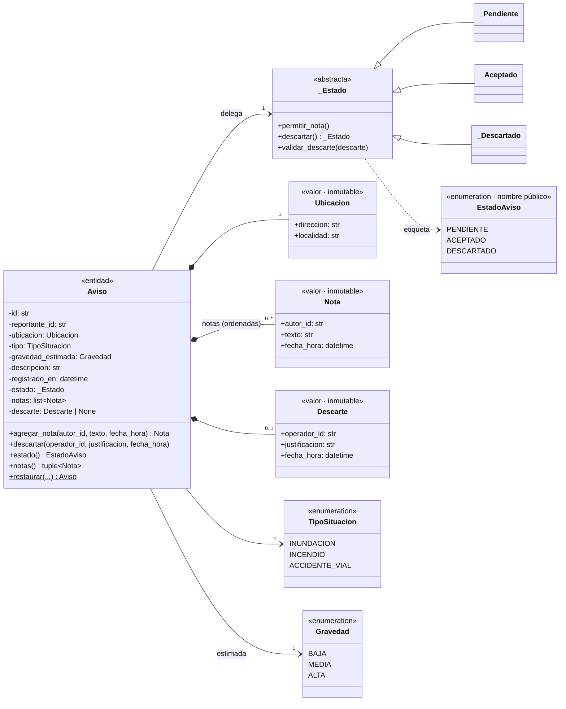
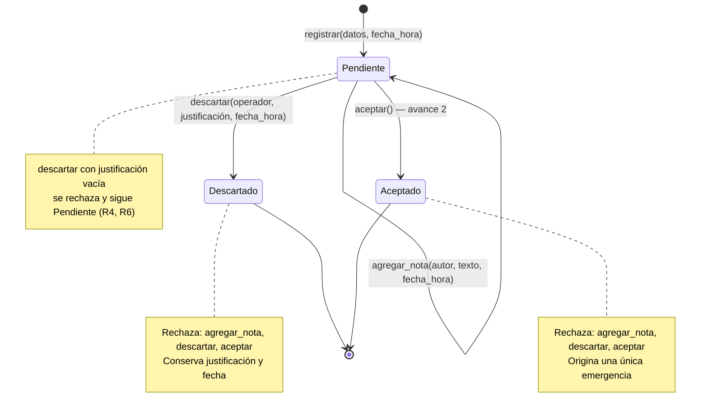

# Avance 1 — Avisos y notas

Rebanada vertical: **registrar** un aviso, **agregarle notas** y **descartarlo** (§2.1, §7.1).
Dominio en Python puro (sin FastAPI, Pydantic ni Mongo).

## 1. Diagrama de clases

**Por qué así**

- `Aviso` es la única **entidad**: tiene identidad (`id`) y cambia de estado.
- `Ubicacion`, `Nota` y `Descarte` son **objetos valor** (`@dataclass(frozen=True)`): se validan al nacer, no cambian y no tienen identidad propia. Una nota sin autor o un descarte sin justificación no pueden existir.
- Composición (`*--`): las notas y el descarte no viven fuera de su aviso.
- `TipoSituacion` y `Gravedad` son `Enum`: un valor fuera de catálogo no se puede construir.
- `aviso.notas` devuelve una **tupla**: desde afuera no hay `append`, la única puerta es `agregar_nota()`.
- El **estado es un objeto** (State): `Aviso` no pregunta "¿estás pendiente?", le delega a `_Estado` (`permitir_nota()`, `descartar()`). El objeto estado no sale del aviso: afuera solo se ve `aviso.estado`, que devuelve el nombre (`EstadoAviso`).
- Sin comparar clases: la pertenencia a los catálogos se verifica con `Catalogo.contiene()` y los datos obligatorios con `_hay_texto()`.

## 2. Diagrama de estados del aviso

| Operación       |