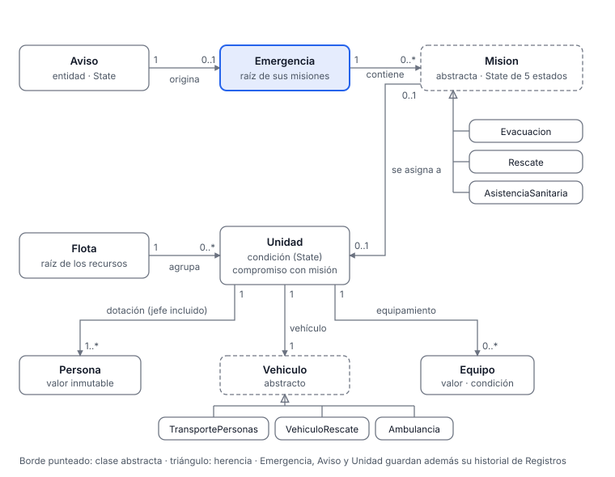
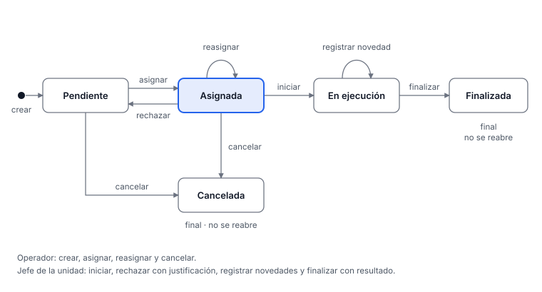

<!-- _class: portada -->
<!-- _paginate: false -->
<!-- _footer: "" -->

# CRCE — Centro Regional de Coordinación de Emergencias

Primera entrega: análisis y modelo de dominio

Francisco Acuña · Paradigmas de Programación V · FIE-UNDEF · 24/11/2026

<!--
Presentación de 10 a 12 minutos. El dominio ya está implementado y probado (204 tests); lo que se muestra es el diseño que lo sostiene y por qué.
-->

---

## De un aviso a una misión

**Aviso → Emergencia → Misiones → Unidad.** El sistema coordina, no decide: el operador elige qué misiones crear y qué unidad asignar; el sistema verifica que esa unidad pueda.

- **Un aviso se evalúa una sola vez**: pendiente → aceptado (origina una emergencia) o descartado con justificación.
- **Los requisitos dependen del tipo de misión**, no de la situación. La situación solo limita qué tipos se admiten.
- **Habilitada y comprometida son condiciones distintas**: una unidad en servicio puede estar libre o reservada.

<!--
Si preguntan por qué el sistema no elige la mejor unidad: el enunciado (8.2) lo prohíbe expresamente. El operador decide; el sistema solo verifica.
-->

---

## Cinco perfiles, con límites por relación

| Actor | Hace | Límite |
|---|---|---|
| Reportante | Registra avisos, agrega notas, consulta lo suyo | Solo sus avisos y emergencias; nunca misiones ni recursos |
| Operador | Acepta o descarta, crea misiones, asigna, reasigna, cancela | No inicia ni finaliza por la unidad |
| Jefe de unidad | Inicia, rechaza, registra novedades, finaliza | Solo misiones de **su** unidad |
| Responsable de recursos | Mantiene personal, vehículos, equipos y condición | Solo unidades **libres** |
| Supervisor | Consulta todo, cierra emergencias | No ejecuta ni asigna |

<!--
Idea clave: el perfil no alcanza. Un jefe no puede iniciar la misión de otra unidad aunque ambos sean jefes. Esa regla de relación vive en el dominio (Unidad.exigir_jefe), no solo en la API.
-->

---

## Modelo de dominio

<!--
Tres agregados: el aviso, la emergencia con sus misiones, y la flota con sus unidades. Misiones y vehículos son jerarquías porque lo que cambia entre tipos es comportamiento. Persona, Equipo, Nota, Descarte, Resultado y Registro son valores inmutables.
-->

---

## La misión solo avanza por transiciones válidas

<!--
Cinco estados, ocho transiciones. Finalizada y Cancelada son finales: no se reabren. Reasignar y rechazar no existen en ejecución (el enunciado deja fuera averías e interrupciones).
-->

---

## Decisión 1 — El estado decide qué se admite

{{codigo dominio/mision.py:_Estado.asignar}}

{{codigo dominio/mision.py:_Asignada}}

La misión delega en su estado y nunca pregunta «¿estás asignada?». Lo que un estado no sobrescribe, se rechaza.

<!--
Por qué State y no booleanos: los if estado == ... se repiten en cada operación y se contradicen. Con State, sumar una transición toca un solo lugar. Cada estado devuelve el estado siguiente.
-->

---

## Decisión 2 — El tipo decide qué necesita

{{codigo dominio/mision.py:Rescate sin-doc}}

{{codigo dominio/vehiculos.py:TransportePersonas.verificar_evacuacion}}

La unidad le pregunta a la misión; la misión, al vehículo (doble despacho). Sin `isinstance`: un test lo vigila sobre el código fuente.

<!--
Si preguntan cómo se agrega un cuarto tipo de misión: una clase nueva con sus puestos, su vehículo y su equipo. No se toca Unidad ni Emergencia.
-->

---

## Decisión 3 — Personas distintas, no nombres

{{codigo dominio/distribucion.py:existe_distribucion sin-doc}}

Ana (conducción + rescate), Bruno (conducción), Carla (rescate) cubren un rescate: Bruno conduce, Ana y Carla rescatan. Ana sola no cuenta dos veces.

<!--
El enunciado pide verificar que EXISTA un reparto, no asignar personas a puestos. Es búsqueda con retroceso; con unidades de pocas personas el costo es despreciable y la respuesta es exacta.
-->

---

## Decisión 4 — Fallar antes de modificar

{{codigo dominio/mision.py:Mision.reasignar}}

La unidad nueva se compromete **antes** de liberar la anterior. Si no cumple, todo queda como estaba y no se registra nada (PV18).

<!--
Misma idea en toda operación: validar todo primero, construir los valores (que se autovalidan) y recién después cambiar el objeto. El registro histórico se escribe después del éxito.
-->

---

## Otras decisiones que se pueden defender

- **Emergencia como raíz de sus misiones**: toda operación pasa por ella y las misiones salen como vistas de solo lectura.
- **Flota como raíz de los recursos**: «nada está en dos unidades» cruza todas las unidades; ninguna puede garantizarlo sola.
- **Historial inmutable** dentro de cada agregado: actor, fecha, operación, recursos y detalle (unidad anterior y nueva).
- **Fechas como parámetro**: el dominio nunca llama a `datetime.now()`.
- **Dominio solo con biblioteca estándar**: se prueba sin servidor ni base.
- **Reglas de negocio en el dominio; perfiles en la aplicación.**

---

## API HTTP en cuatro capas

| Capa | Responsabilidad | Tecnología propuesta |
|---|---|---|
| Presentación | Rutas, formato, errores → códigos HTTP | FastAPI + Pydantic |
| Aplicación | Un servicio por caso de uso; **autoriza por perfil y por relación**; una transacción | Python puro |
| Dominio | Entidades, estados y reglas | Biblioteca estándar |
| Infraestructura | Repositorios, hashing, tokens, reloj | MongoDB, argon2, JWT |

**Rechazos:** 401 sin credenciales · 403 perfil o relación · 404 no existe · 409 choca con el estado · 422 datos inválidos o unidad que no puede cumplir (con el motivo exacto).

<!--
Las dependencias apuntan hacia el dominio, que no conoce a nadie. La atomicidad de PV18 se resuelve con una transacción en la base; el dominio ya falla antes de modificar, así que no hay estado a medias que deshacer.
-->

---

## Operaciones principales

| Operación | Ruta | Actor |
|---|---|---|
| Aceptar aviso | `POST /avisos/{id}/aceptacion` | Operador |
| Crear misión | `POST /emergencias/{id}/misiones` | Operador |
| Asignar / reasignar | `POST /misiones/{id}/asignacion` · `/reasignacion` | Operador |
| Iniciar / rechazar / finalizar | `POST /misiones/{id}/inicio` · `/rechazo` · `/finalizacion` | Jefe de su unidad |
| Cerrar emergencia | `POST /emergencias/{id}/cierre` | Supervisor |
| Cambiar composición o condición | `/unidades/{id}/personal` · `/vehiculo` · `/equipos` · `/condicion` | Responsable de recursos |

---

## Verificación

- **204 tests** del dominio; cada nombre dice la regla que prueba.
- **23 mutaciones** de reglas, una por una: los tests fallaron en todas.
- **mypy** sin errores en dominio y tests.
- Escenarios **PV02 a PV18** cubiertos en el dominio; PV01, parte de PV12 y PV19 dependen de la API y la interfaz.

Repositorio: github.com/franacu/ProyectoFinal-PP5 · tag `avance-1`

---

## Hacia la entrega final

1. **Persistencia**: repositorios MongoDB con transacción (réplica de un nodo en Docker Compose).
2. **API FastAPI** en capas, con los servicios de aplicación y el mapeo de errores.
3. **Autenticación y autorización**: JWT, hashing seguro, carga inicial de cinco cuentas.
4. **Interfaz gráfica** de formularios y listados para los cinco perfiles (PV19).
5. **Dockerfile, Docker Compose y colección Bruno** para los casos negativos.
